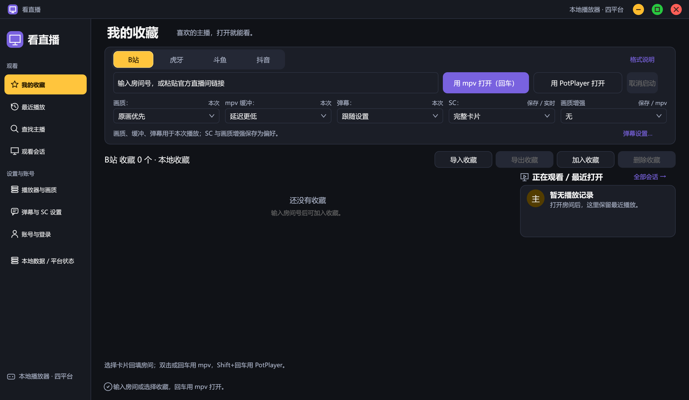

# 看直播 · jubo-live-rust

在「播放器与画质 → 播放外观」可以为 mpv 和 PotPlayer 分别选择沿用原设置或软件附带的定制外观。选择会在下次打开该播放器时生效。[外观与首次准备](docs/player-styles.md)

Windows 多平台直播工具，支持 B站、虎牙、斗鱼、抖音，使用 mpv 或 PotPlayer 播放，提供弹幕、SC、收藏、历史和主播搜索。

[下载 Windows x64 版](https://github.com/xinshengxia/jubo-live-rust/releases) · [使用说明](docs/getting-started.md) · [反馈问题](https://github.com/xinshengxia/jubo-live-rust/issues)

## 三步开始

1. 下载发布页的 `win-x64-lite.zip`，完整解压后运行 `live-hub-rust.exe`。
2. 打开“播放器与画质”，选择已有 mpv / PotPlayer 程序，或桌面、开始菜单的 `.lnk` 快捷方式；检测通过后自动保存真实程序位置。没有播放器时使用“获取兼容 mpv”。
3. 输入直播间链接或“平台:房间号”，打开直播；平台需要登录或验证时，再到“账号与登录”操作。

> **mpv 默认需要 OpenAL。** 较新版本和“完整版”也可能没有此能力，应用会实际检测。[已检查的构建和下载方法](docs/tool-setup.md#mpv)。

推荐获取来源：**[shinchiro/mpv-winbuild-cmake](https://github.com/shinchiro/mpv-winbuild-cmake)**。本次已检查 [20261021 的 Windows x64 构建](https://github.com/shinchiro/mpv-winbuild-cmake/releases/tag/20261021)，实际 `--ao=help` 含 OpenAL；其他日期或架构的构建请重新检测。

## 下载哪个包

本轮提供 **lite**（不捆绑播放器或 yt-dlp）及源码 ZIP。已有工具可以直接选择，无需重新下载。暂不提供 full 包；不要把历史提到的 full 当成本版可下载的资产。以 Release 的实际附件为准。

当前版本为 **1.0.17**。主界面左下角可检查更新，支持自动检查更新，点击安装后等待直播结束并自动替换。「观看会话」可查看 mpv 的 A-V、两类丢帧和前向缓存，标记时保存当次采样；PotPlayer 显示可读取的播放状态和位置。[会话指标说明](docs/getting-started.md#播放器实时指标) · [播放器外观与使用说明](docs/player-styles.md) · [1.0.12 变化](docs/release-notes-1.0.12.md) · [1.0.10 功能更新](docs/release-notes-1.0.10.md) · [历史版本](https://github.com/xinshengxia/jubo-live-rust/releases)

## 主要功能

- 四平台直播取流与房间解析
- mpv / PotPlayer 播放与画质偏好
- 弹幕、SC 和直播事件覆盖层
- 本地收藏、播放历史与观看会话
- 主播搜索与账号核验
- 平台登录状态管理和本机加密凭据

## 要登录平台账号吗

无需先登录四个平台。下表说明 **1.0.9 的代码行为**，核对日期 2026-11-17。本轮已完成抖音真实扫码、加密保存及独立进程重载核验；四平台登录前后真实观看、画质、搜索和弹幕的逐项对照仍待验收；不能把支持某条代码路径当成实播成功。

| 平台 | 观看 / 取流 | 画质 | 搜索 / 房间解析 | 弹幕接收 | 登录与验证的影响 |
| --- | --- | --- | --- | --- | --- |
| B站 | 有匿名路径，普通公开房间实播待对照 | 游客 / 账号档位差异待验证；受权益限制 | 有匿名路径，实际效果待对照 | 有匿名及账号认证路径，接收差异待对照 | 保存会话用于有作用域的请求和认证；不保证全部画质 |
| 虎牙 | 有匿名路径，实播待对照 | 登录是否增加档位待验证 | 有匿名路径，实际效果待对照 | 有匿名路径，账号效果待对照 | 有官网登录与健康核验；不预先承诺功能提升 |
| 斗鱼 | 有匿名路径，实播待对照 | 游客 / 账号档位差异待验证 | 有匿名路径，实际效果待对照 | 有匿名路径，账号效果待对照 | 官方 SSO 核验；只有业务 Cookie 时不武断判失效 |
| 抖音 | 有取流路径，部分请求可能要求登录或验证 | 登录前后档位差异待验证 | 有搜索 / 解析路径，可能遇到空结果或验证 | 有接收路径，可能被验证拦截 | 专属窗口登录后自动核验并保存；网页登录与账号有效分开判断，登录后仍可能要求验证 |

网页登录成功后，必须由应用确认并保存，才能使用该登录状态。接收弹幕、发送弹幕和账号权益是不同能力；应用不提供发送弹幕功能。

## 依赖与数据

- **[yt-dlp/yt-dlp GitHub 项目](https://github.com/yt-dlp/yt-dlp)**：当前仅用于 B站原生取流部分错误时的可选回退，不是四平台播放、搜索和弹幕的统一前置依赖。已有程序或快捷方式可直接选择；没有时可按需从官方 Release 下载并校验。不会附带安装 Deno / FFmpeg。[配置说明](docs/tool-setup.md)
- 登录使用本应用独立 Edge / Chrome 资料，不读取日常浏览器、其他应用的凭据或历史；凭据通过本机 Windows DPAPI 加密。
- 数据目录优先级与升级方法见 [使用说明](docs/getting-started.md)。保留个人数据；DPAPI 凭据不保证跨电脑可解密。
- 程序未做代码签名。只从本仓库发布页获取，保留系统安全防护。

## 常见问题

**需要先登录全部平台吗？** 不需要；遇到具体请求的登录或验证要求再操作。网页登录后还需应用核验并保存。登录不保证额外画质或绕过账号权益。

**已有播放器和 yt-dlp，还要重新下载吗？** 不需要。选择程序或快捷方式即可；mpv 会额外检查 OpenAL。

**为什么新版 mpv 仍不兼容？** OpenAL 取决于构建选项。优先使用上面的已检查构建，或在应用中重新检测自己的版本。

**收藏、历史要登录才能用吗？** 它们保存在本地，不依赖平台登录，也不等于平台关注列表或订阅同步。

**升级后数据在哪里？** 显式数据目录优先；便携包通常使用包内 `data/`，其他布局通常使用 `%LOCALAPPDATA%/LiveHubRust`。升级前保留旧数据，完整优先级和步骤见 [使用说明](docs/getting-started.md)。

## 文档与开发

[登录与验证](docs/login.md) · [播放说明](docs/relay-playback.md) · [验证范围](docs/validation.md) · [架构](docs/architecture.md) · [许可证](LICENSE) · [第三方声明](THIRD_PARTY_NOTICES.md)

构建：安装 Rust Windows GNU 工具链后运行 `scripts/Build.ps1 -Release`；离线测试：`scripts/Test.ps1`。具体依赖与授权见仓库文档。
