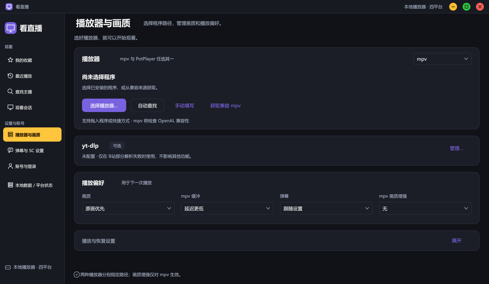

# 使用说明

完整解压 Windows x64 lite 包，运行 `live-hub-rust.exe`。不要直接在 ZIP 内启动。

## 准备播放器

在“播放器与画质”的播放器卡片中选择 mpv 或 PotPlayer，然后选择 `.exe` / `.lnk`，或直接拖入对应卡片。粘贴路径可点“手动填写”。yt-dlp 位于可选工具卡片，点“管理…”展开；也可直接拖入该卡片。导入只解析快捷方式的真实目标，不运行链接，不继承其自带参数、工作目录或包装脚本。检测通过后保存 exe 真实位置，删除来源快捷方式不会使设置失效。

主卡片直接显示检测和保存结果。mpv 会运行有超时的版本和 OpenAL 探测；PotPlayer 只读版本资源，不为探测打开播放器。文件存在、程序版本、OpenAL 能力和实播结果分别表述。失败保留已保存的旧配置，可重新选择、重新检测或获取兼容构建。

已有 yt-dlp 可直接导入，无需重新下载。它仅用于 B站原生解析的可选回退；其他功能不要求先装它。[工具获取](tool-setup.md)

## 登录

B站使用官方二维码，过期自动换码。虎牙、斗鱼、抖音打开本应用的专属浏览器窗口，扫码和验证由本人完成，后台定期核验；也可手动重试。只有平台确认有效、核验前后候选会话一致时才加密保存；网络未知、验证未完成和保存失败分别显示。切换平台、取消后重新打开会丢弃旧任务结果。

专属窗口失去关联时，取消本次登录后重新打开；不扫描日常浏览器或未知调试端口。网页验证通过不等于账号已登录。成功保存后可重开应用，在账号页复查登录状态。

## 数据与升级

优先级：显式 `--data-dir` → 子进程继承的 `LIVE_HUB_DATA_DIR` → 包旁存在 `portable.marker` 或 `bin/mpv/mpv.exe` 时使用包内 `data/` → `%LOCALAPPDATA%/LiveHubRust` → 非 Windows 的 XDG 目录或程序旁 `data/`。

本版 lite 包带 `portable.marker`。升级前关闭本应用并保留原版完整目录，解压新包到新目录；便携数据需由用户复制旧 `data/` 后使用，也可显式指定原数据目录。不要把原数据、Cookie 或 profile 上传到问题反馈。只读安装目录请显式指定可写数据目录。

收藏、历史、播放器设置和凭据格式保持兼容；未执行的跨版本真实数据升级不能视作通过。Windows DPAPI 绑定当前系统/用户，换电脑时通常需要重新登录。

## 播放器实时指标

「观看会话」中选择正在播放的房间，可查看 mpv 最近一秒采样的 A-V 偏差（正值表示声音领先）、累计解码及输出丢帧、前向缓存秒数。点「标记音画异常」会读取当时最新的采样并写入本地诊断日志。缺失字段显示为 —，超过 4 秒的旧样本不作为当前数值。PotPlayer 单列其可读取的播放状态和位置；播放器内部三项统计显示不可用，中转计数另列。

## 检查更新

点主界面左下角的「检查更新」。默认在启动器运行时定期检查正式版，也可在更新窗口关闭自动检查。发现新版后点击「更新」，程序会校验发布者签名、安装包 SHA-256 与包内文件清单，等待观看会话结束，再替换并重新打开启动器。收藏、历史、账号和自定义程序路径保留。

直连失败时会尝试备用清单 CDN 和公开附件下载线路。无法联网时，可在另一台电脑下载对应 ZIP 和同次发布的签名文件 channel.json，再点「从本地安装」。C# 的 full/lite 分别对应原安装类型，Rust 使用 Windows x64 lite 包。签名文件只包含版本和公开附件校验信息。
